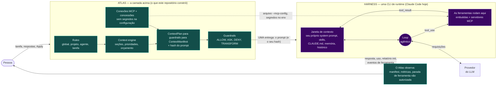
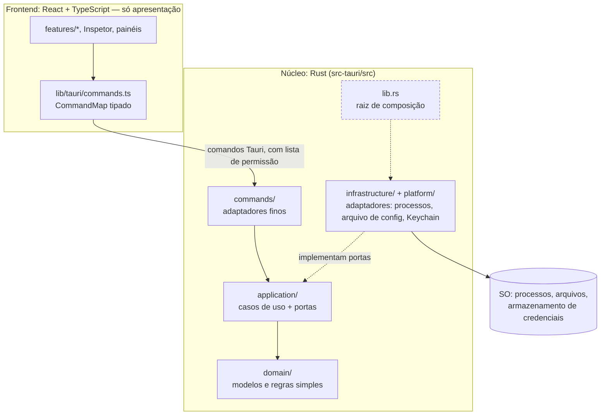
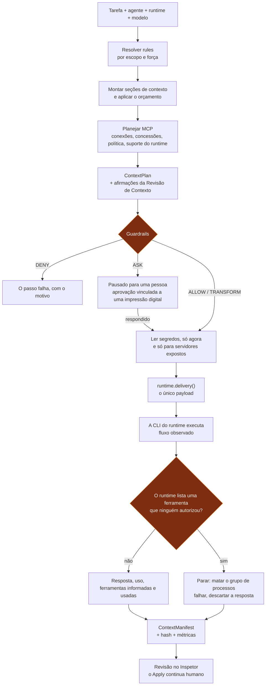
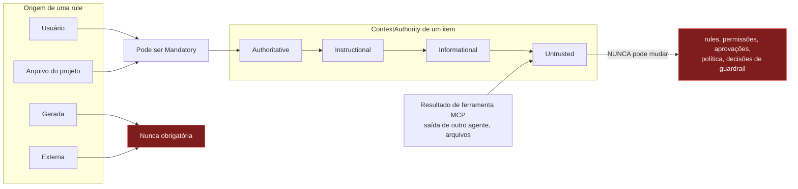
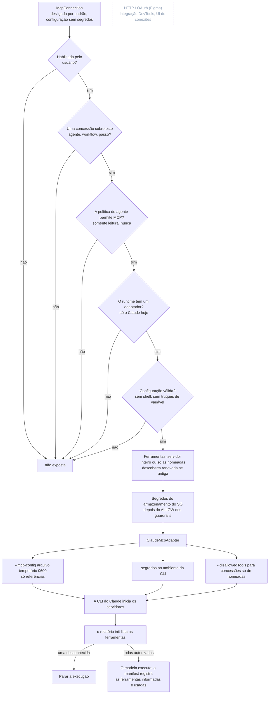
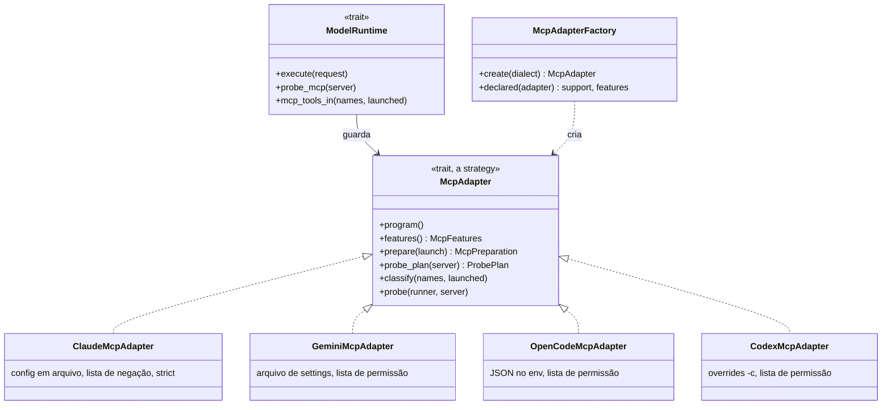

# O Atlas em diagramas

Figuras do que o código faz hoje. São [Mermaid](https://mermaid.js.org) (GitHub, VS Code e a maioria dos visualizadores os
desenham; o código-fonte fica no git e é revisado como código). Toda caixa existe no código; o que ainda não existe é
desenhado tracejado e diz isso. As palavras por trás de cada figura estão em
[context-and-tooling-platform.md](context-and-tooling-platform.md).

## 1. O Atlas e o harness de agentes

Um **harness** de agente de código (Claude Code, Codex, Gemini CLI…) guarda a janela de contexto, executa o loop agêntico
e executa as ferramentas. O Atlas não o substitui: **o Atlas fica um nível acima, decide o que entra no harness e observa
o que volta.** Essa é a principal diferença em relação à figura usual de "harness".

Como cada caixa da figura usual se mapeia:

| Na figura usual                   | No Atlas                                                                                                                                                                                                    |
| --------------------------------- | ----------------------------------------------------------------------------------------------------------------------------------------------------------------------------------------------------------- |
| System prompt                     | O do próprio runtime **não é do Atlas** (entrada de superfície "controlado pelo runtime"). As instruções do Atlas viajam dentro do corpo do prompt (`SystemPromptChannel::Unsupported` nos cinco runtimes). |
| Rules (`CLAUDE.md`)               | O Atlas tem suas próprias Rules (`.atlas/context/rules.md`, `UserConfig.rules`, rules de tarefa). O `CLAUDE.md` do usuário é carregado pela CLI e o Atlas o lista como "não observado".                     |
| Skills                            | Desligadas nas execuções do Claude (`--disable-slash-commands`).                                                                                                                                            |
| Esquemas de ferramentas / MCPs    | O Atlas decide **quais servidores e ferramentas** (concessões, plano). Ele não vê esquemas nem descrições (desconhecidos, então `tool_definitions` é Unknown no orçamento).                                 |
| `Memory.md`                       | Não construída. A Memory está desenhada (doc seção 6), explicitamente adiada.                                                                                                                               |
| Histórico                         | Parte do prompt que o Atlas monta (conversa e contexto da tarefa), sob o mesmo orçamento e prioridades.                                                                                                     |
| Janela de contexto / payload      | O **Manifest**: o que foi entregue, com um SHA-256 do payload exato. O que a CLI acrescenta em volta é mostrado como não observado, nunca afirmado.                                                         |
| Loop agêntico                     | Pertence ao harness. O Atlas o inicia, pode pará-lo, e só vê o que a CLI informa.                                                                                                                           |
| Ferramentas executadas no harness | Igual. O Atlas nunca executa uma ferramenta por conta própria e não tem gateway nem proxy de MCP.                                                                                                           |

## 2. Camadas da aplicação

A webview nunca toca em arquivos, processos, Git, credenciais nem na rede. As dependências apontam para dentro (ADR 0002).

## 3. Um passo, da requisição à evidência

O que o `ExecutionService::run_step` faz, em ordem.

## 4. Quem decide o quê: autoridade e confiança

Dois eixos que nunca se fundem: **de onde o conteúdo veio** (`SourceTrust`) e **o que ele pode ser para o modelo**
(`ContextAuthority`). Só as rules do próprio usuário podem obrigar.

## 5. MCP: de uma conexão a uma ferramenta em um passo

A caixa tracejada é a Fase E: não construída.

## 6. MCP entre runtimes: Strategy e Factory

Cada CLI recebe servidores MCP no seu próprio dialeto. O Atlas fala com todas por uma só interface (**Strategy**:
`McpAdapter`), e um só lugar escolhe o dialeto (**Factory**: `McpAdapterFactory`). Um runtime guarda um adaptador e não
sabe de qual CLI é o dialeto que fala; o catálogo de integrações conhecidas é construído da mesma forma (`McpPreset`,
`McpPresetFactory`).

`McpFeatures` é o que o plano lê (não um `match` no runtime): `tool_filter` (lista de negação, lista de permissão, não
suportado), `probe` (nenhuma, status, ferramentas) e `strict`. O Antigravity não pode receber servidores, então declara
`cli_configured`: o plano casa uma conexão com os servidores que `agy mcp list` mostra e diz ao agente para usar aquele.

## Mantê-los verdadeiros

Um diagrama que se desatualiza é pior que nenhum. Quando um passo das seções 3 ou 5 mudar no código, mude-o aqui no
mesmo commit. Os blocos Mermaid são texto simples, então um revisor vê o diff.
