# Relatório — repaginação de Agentes e Personalidades

Branch `design/workspace-harness` (continuação do módulo 1). Referência: [`../stitch/`](../stitch/). Levantamento: [`levantamento.md`](levantamento.md). Capturas do app a 1440×900 com o harness de `_comum/captura/` (`?agents=3&custom=1&runtimes=down`).

## 1. Por tela

### A1. Agentes — Lista de agentes — fiel com ajustes

Resumo em uma linha, abas sublinhadas, cartões sem caixa interna, Editar + ⋯. Sem ícone por personalidade; moldura do Stitch ignorada.

| Antes                                   | Stitch                                    | Depois                               |
| --------------------------------------- | ----------------------------------------- | ------------------------------------ |
| 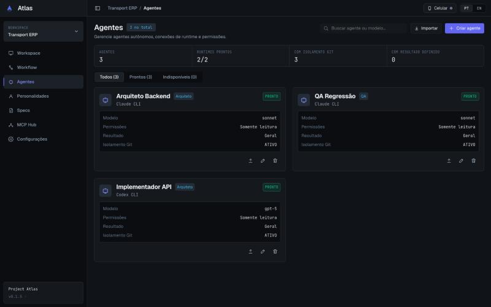 | 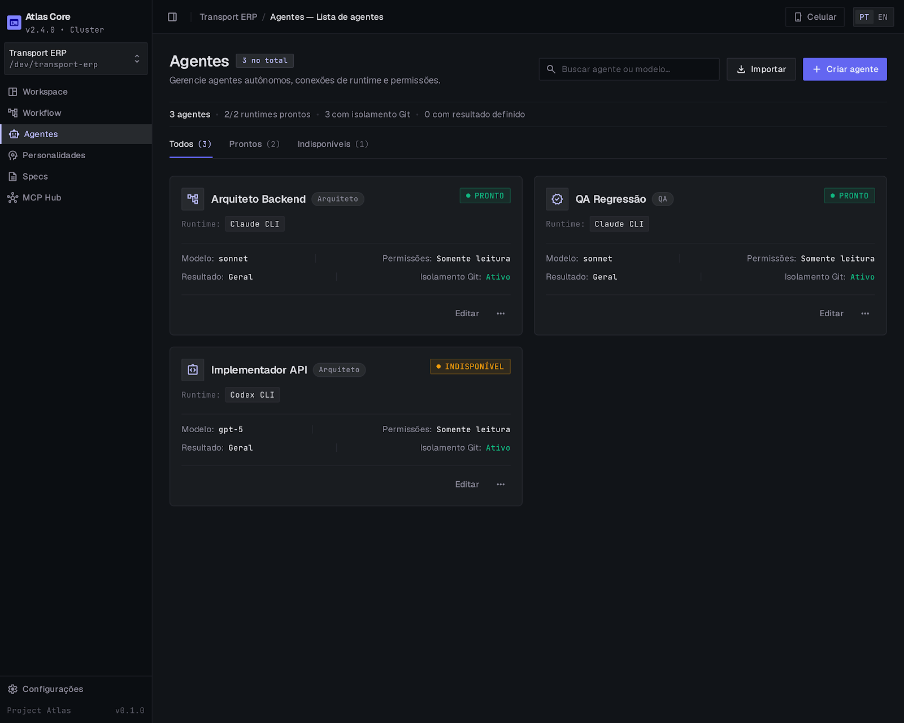 | 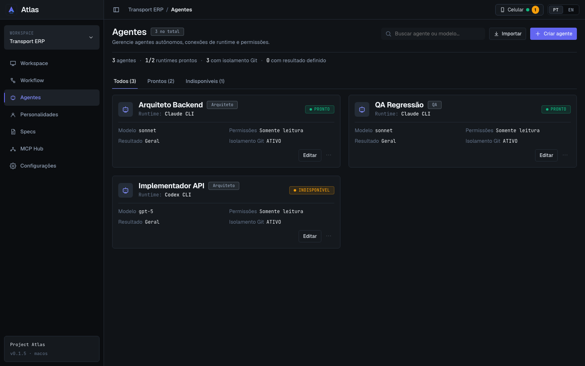 |

### A2. Agentes — Sem agentes — fiel

Estado vazio com o texto atual e Criar agente (como no Stitch, o botão também está no cabeçalho).

| Antes                              | Stitch                                    | Depois                               |
| ---------------------------------- | ----------------------------------------- | ------------------------------------ |
| _não capturado (lacuna do dossiê)_ | 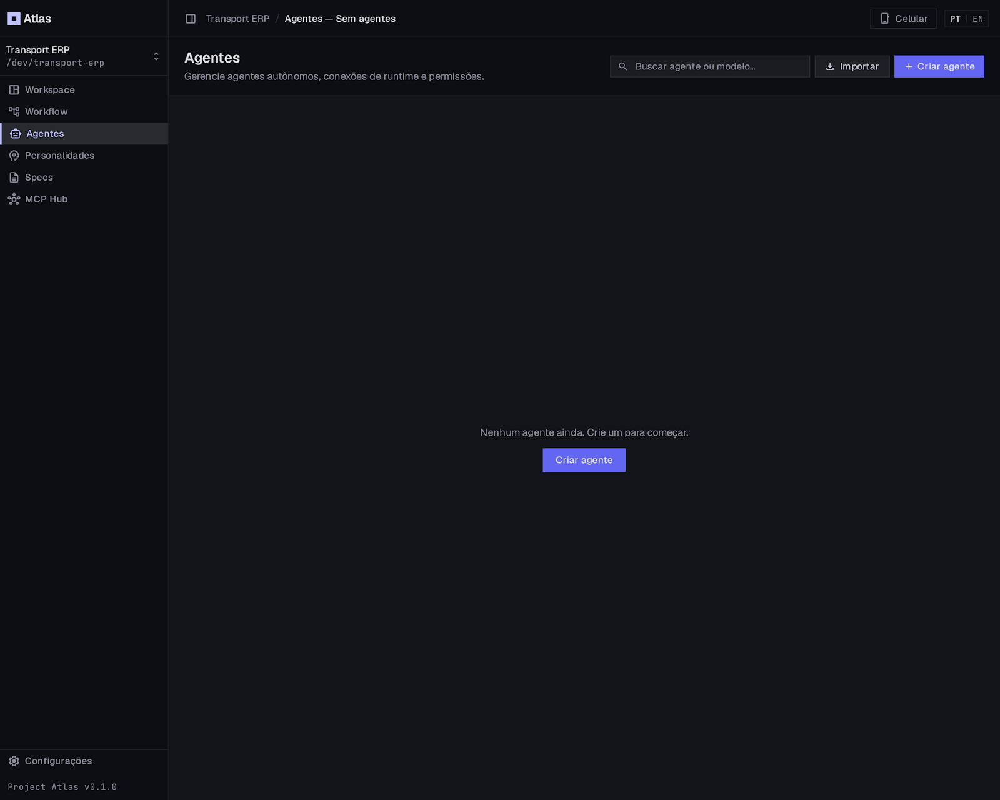 | 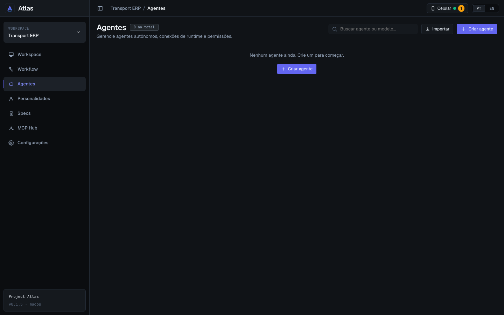 |

### A3. Agentes — Criar e editar agente — fiel com ajustes

Mesmas cinco seções e rodapé fixo; sem marcador nos títulos; Detectar runtimes no cabeçalho da seção; voltar para Agentes. Subtítulo e textos inventados não implementados.

| Antes                                             | Stitch                                        | Depois                                   |
| ------------------------------------------------- | --------------------------------------------- | ---------------------------------------- |
| 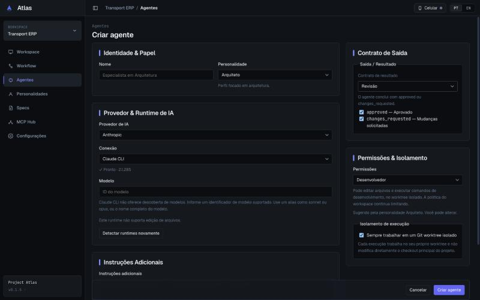 | 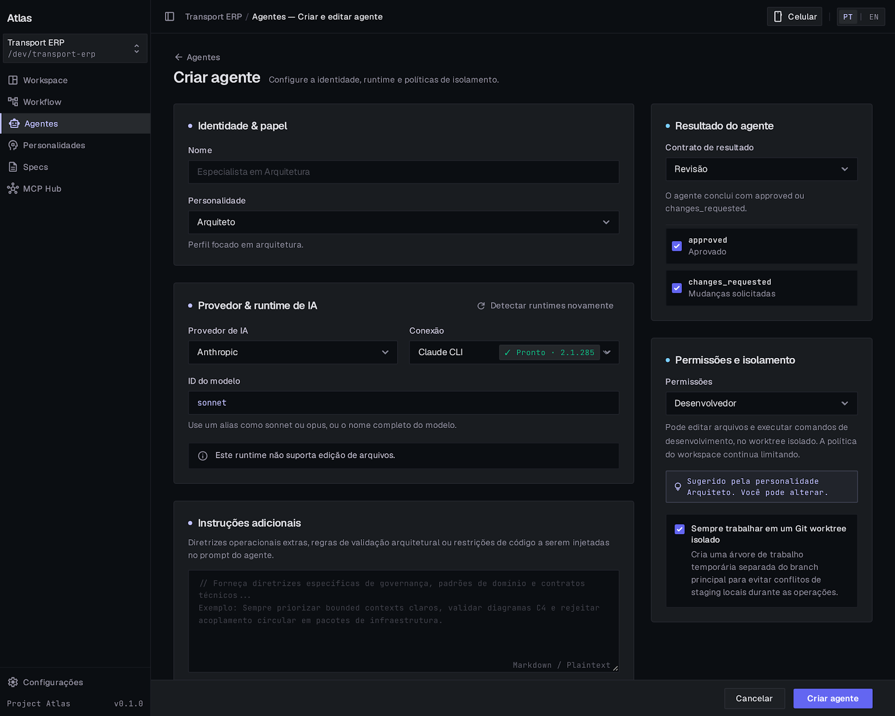 | 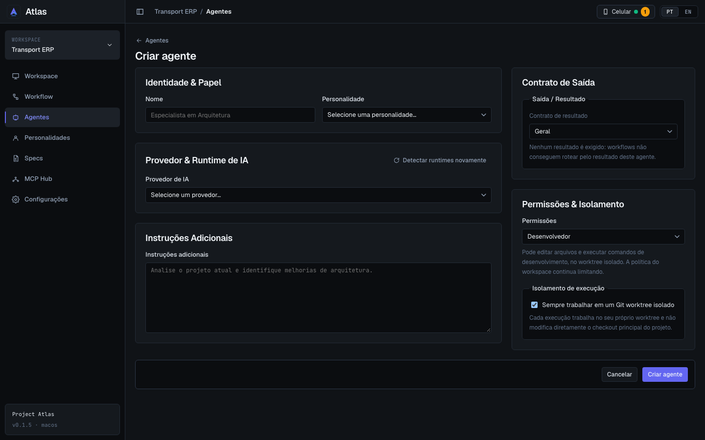 |

### P1. Personalidades — Biblioteca — fiel com ajustes

Cartões compactos (um aberto por vez), aviso global recolhido, Usar + ⋯. Título continua "Personalidades".

| Antes                                                    | Stitch                                                | Depois                                           |
| -------------------------------------------------------- | ----------------------------------------------------- | ------------------------------------------------ |
| 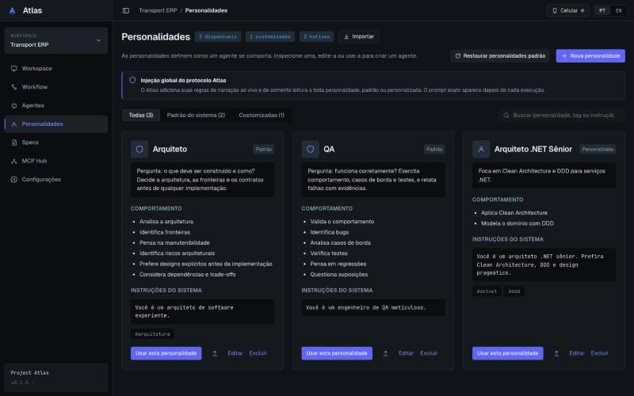 | 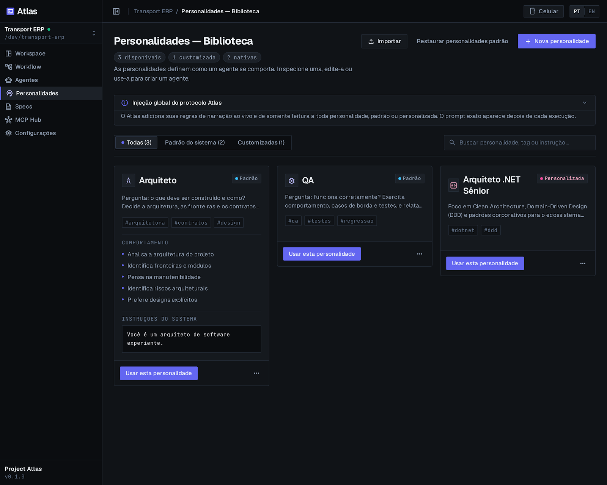 | 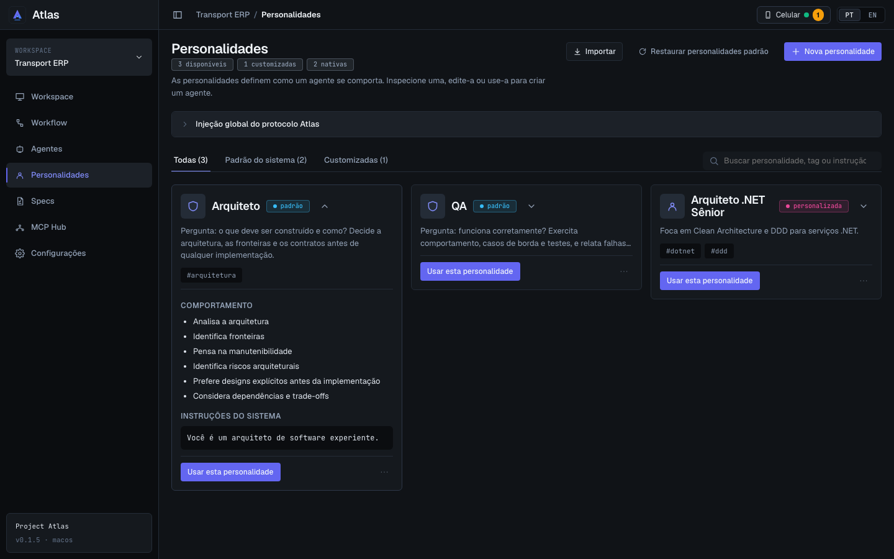 |

### P2. Personalidades — Nova e editar personalidade — fiel com ajustes

Painel lateral sobreposto; o campo de instruções ocupa a altura que sobra. Placeholder do app.

| Antes                                         | Stitch                                           | Depois                                      |
| --------------------------------------------- | ------------------------------------------------ | ------------------------------------------- |
| 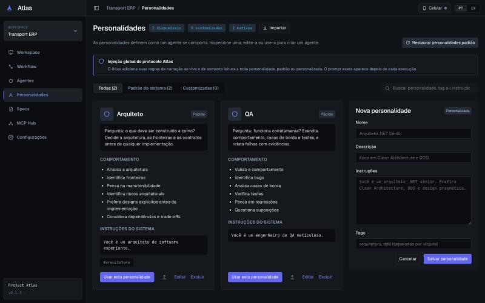 | 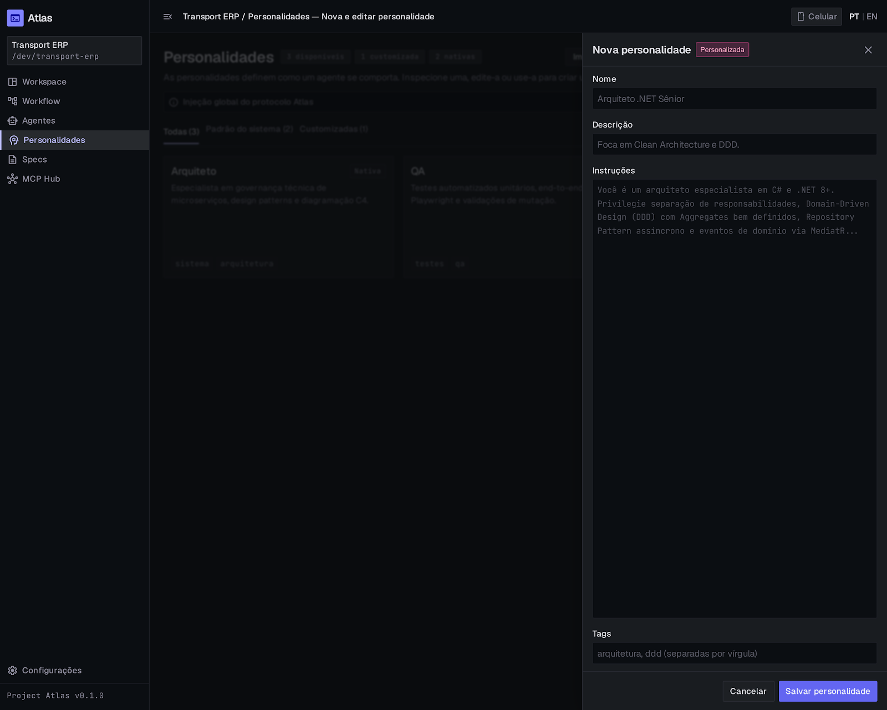 | 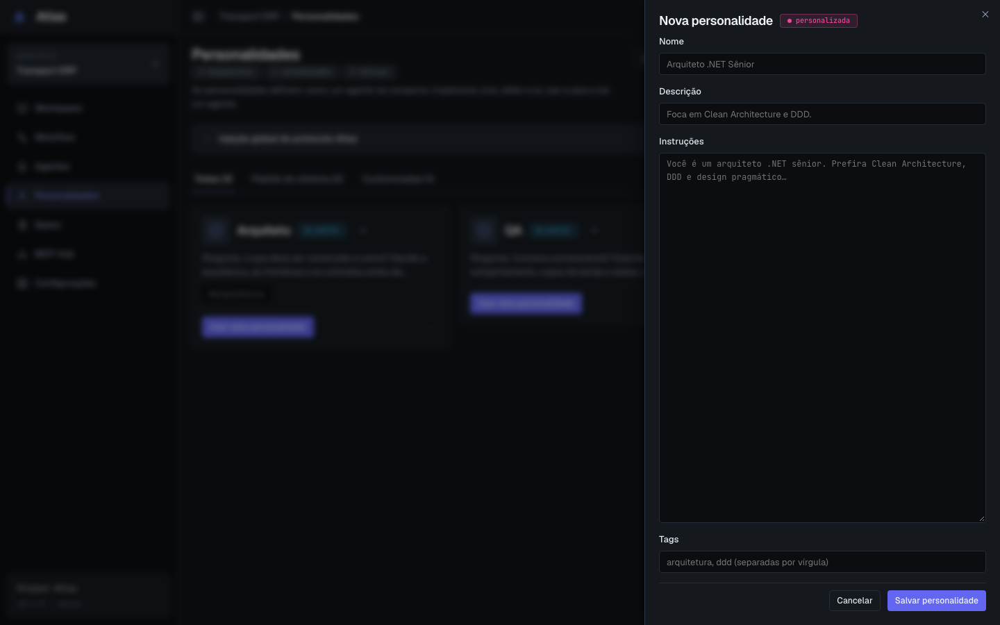 |

### Conferido fora das cinco telas

O painel "Editar agente" do Workspace usa o mesmo `AgentForm`: 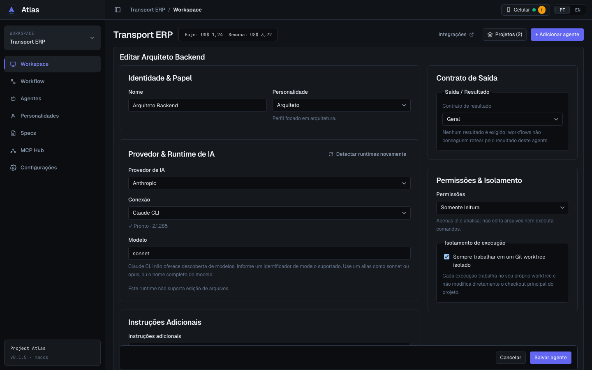

## 2. O Stitch mostra, o app não tem (não implementado)

- Moldura: "Atlas Core · v2.4.0 · Cluster", versão "v0.1.0", ponto verde no workspace, "Configurações" separado.
- Agentes: ícone diferente por personalidade; subtítulo "Configure a identidade, runtime e políticas de isolamento."; placeholder e ajuda de "Instruções adicionais"; "Markdown / Plaintext".
- Personalidades: placeholder longo de instruções (C#, MediatR); rótulo "Nativa" (o app diz "Padrão").

## 3. Stitch omitiu, app manteve

- Os quatro números do resumo de agentes (o Stitch os pôs numa linha, não os tirou).
- Confirmação inline de excluir agente e personalidade, e a mensagem de erro de "agente trabalhando" / "personalidade em uso".
- Nota de personalidade nativa não editável no painel; aviso "Este runtime não suporta edição de arquivos"; estados de detecção e erro do formulário.
- Explicação do isolamento Git com o texto do app (inclui o aviso quando está desligado).

## 4. Divergências intencionais

- **Título da biblioteca:** "Personalidades" (o Stitch traz "Personalidades — Biblioteca", que é o nome da tela, não do título).
- **Aviso global** recolhível e fechado (o prompt pedia assim; o Stitch o desenhou aberto).
- **Marcador nos títulos de seção do formulário:** removido (o Stitch deixou um ponto; o prompt pedia sem).
- **Excluir e exportar** agora ficam no ⋯ (um clique a mais), como no plano.
- **Painel de personalidade** é um painel lateral sobreposto de 32 rem; clicar fora ou apertar Esc fecha e descarta o rascunho, como qualquer painel do app.
- **Estado vazio** repete "Criar agente" (cabeçalho e corpo), como pedia o prompt do Stitch; nos testes o botão do cabeçalho é o primeiro.

## 5. Componentes compartilhados alterados

| Mudança                                                                                                                                                     | Quem mais usa                                | Verificação                                                       |
| ----------------------------------------------------------------------------------------------------------------------------------------------------------- | -------------------------------------------- | ----------------------------------------------------------------- |
| `Badge`: propriedade `caps` e tom `policy`                                                                                                                  | tudo que usa `Badge` (só acrescenta)         | testes                                                            |
| `AppShell`: a barra lateral recolhe sozinha abaixo de 900 px **enquanto o usuário não tiver escolhido**, e acompanha a janela ao vivo (antes, só no início) | todas as telas                               | testes do `App`; verificado em 720 px nas telas dos módulos 1 e 2 |
| `features/portability/index.ts` exporta `ExportDialog` (para o ⋯ abrir o diálogo de exportar)                                                               | só Agentes e Personalidades                  | testes de exportar                                                |
| `AgentForm`                                                                                                                                                 | também o painel "Editar agente" do Workspace | conferido na captura acima e nos testes do Workspace              |

## 6. `npm run check` e testes alterados

- Linha de base após o merge da `main`: falhava só no `format:check` por documentos novos fora do padrão; corrigido (docs formatados e `.prettierignore` cobre `docs/design-review/*/stitch`).
- Final: ver o resultado no fim deste arquivo.

**Testes alterados (DOM novo, mesmas asserções de comportamento):**

- `AgentsPage.test.tsx`: criar agente clica no primeiro "Create agent" (o estado vazio tem outro); excluir e exportar passam pelo menu ⋯ (`More actions for <agente>`).
- `App.test.tsx`: abre o cartão de Arquiteto antes de procurar a lista de comportamento.
- `PersonalitiesPage.test.tsx`: o cartão começa recolhido (comportamento e instruções aparecem ao expandir); editar, excluir e exportar passam pelo menu ⋯.

## 7. Pendências e sugestões

- **Não verificado:** estados do mock que dependem de erro do núcleo e de runtime sem autenticação no formulário (cobertos pelos testes, não por captura).
- **Responsividade:** `chk.js` (agora também mede rolagem dentro da área principal) limpo em 720, 1100, 1280, 1440, 1920 e 2560 para as telas de Agentes e Personalidades; as do módulo 1 foram reconferidas com o novo medidor.
- Próximo módulo (MCP Hub) pode reaproveitar `Badge` (com `caps`), `OverflowMenu`, `CollapsibleSection` e o padrão de abas sublinhadas (`filterTab`).

- Final: **verde** — typecheck, lint, Prettier, 70 arquivos / 777 testes, `cargo fmt`, `clippy` e `cargo test`. Rust, DTOs e comandos intocados.
