# Relatório — repaginação de Configurações

Branch `design/workspace-harness` (continuação). Referência: [`../stitch/`](../stitch/). Levantamento: [`levantamento.md`](levantamento.md). Capturas a 1440×900 com `_comum/captura/` (`?memory=some|none`).

## 1. Por tela

### C1. Configurações — Geral — fiel com ajustes

Índice interno, grupos separados por linha, controle antes da ajuda, selo do sandbox e "Como funciona" recolhido.

| Antes                                                | Stitch                            | Depois                       |
| ---------------------------------------------------- | --------------------------------- | ---------------------------- |
| 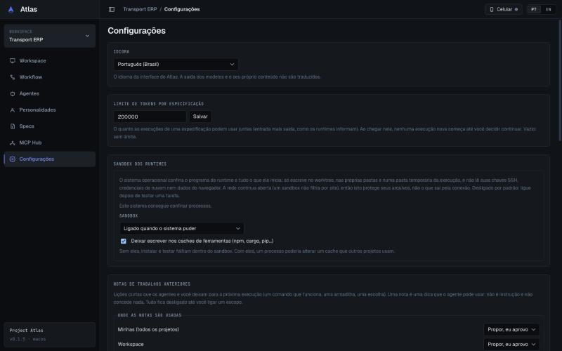 | 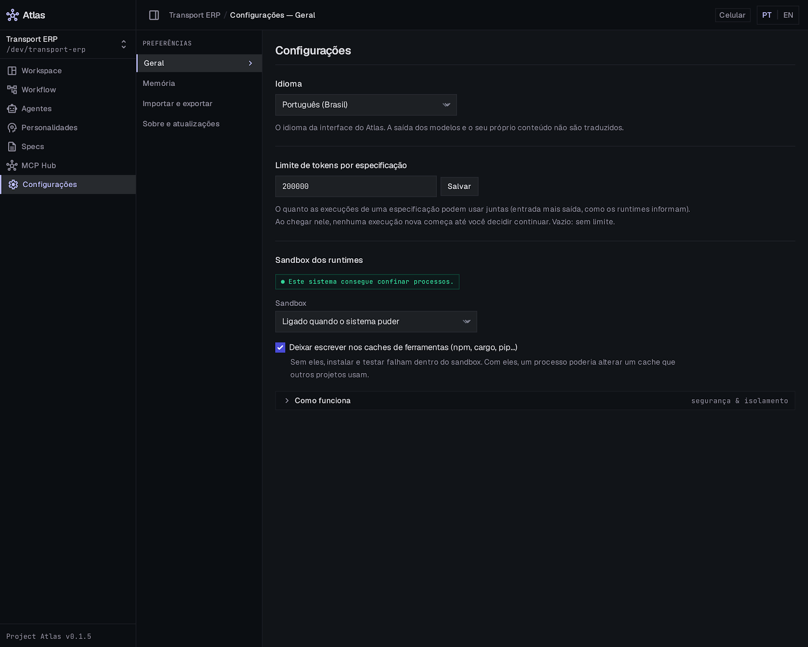 | 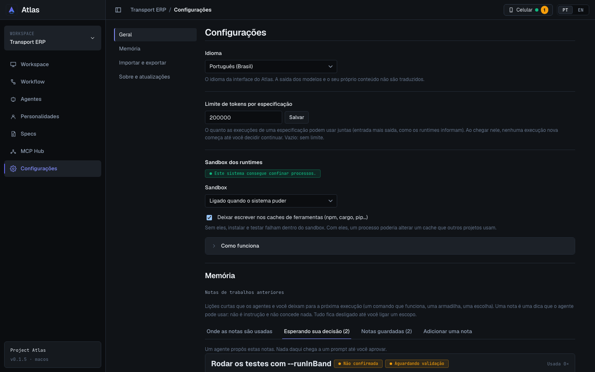 |

### C2. Configurações — Memória — fiel com ajustes

Quatro abas, cartões de nota com selos curtos e ações; as abas que o Stitch não desenhou seguem o mesmo padrão.

| Antes                                     | Stitch                              | Depois                         |
| ----------------------------------------- | ----------------------------------- | ------------------------------ |
| 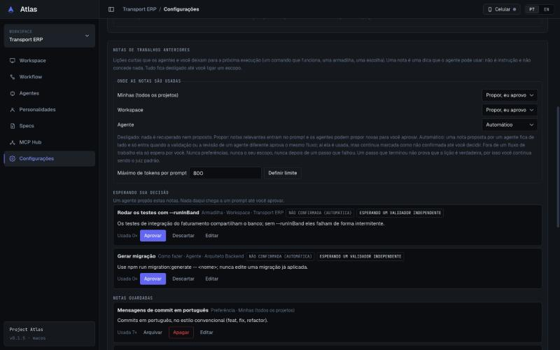 | 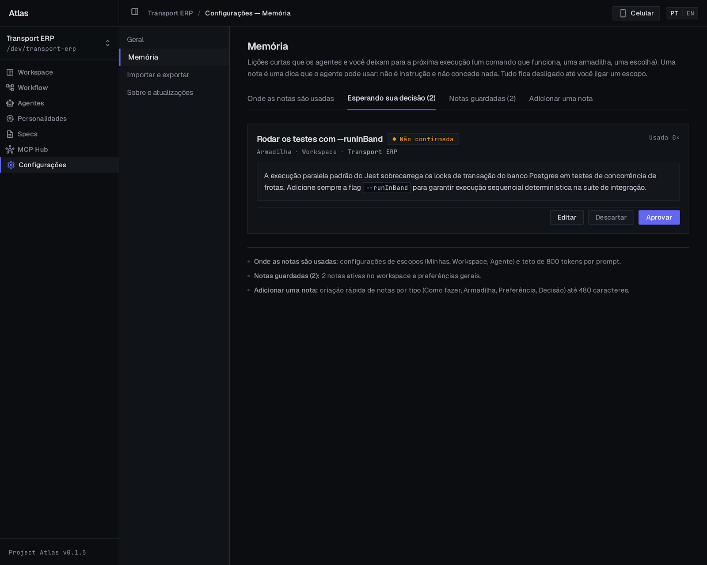 | 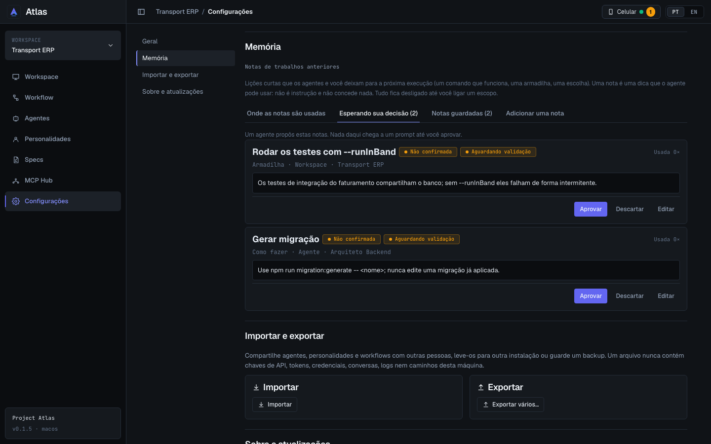 |

### C3. Configurações — Importar e exportar — fiel com ajustes

Dois cartões lado a lado; o passo "O que exportar" abre na página, como antes.

| Antes                                      | Stitch                                        | Depois                                   |
| ------------------------------------------ | --------------------------------------------- | ---------------------------------------- |
| 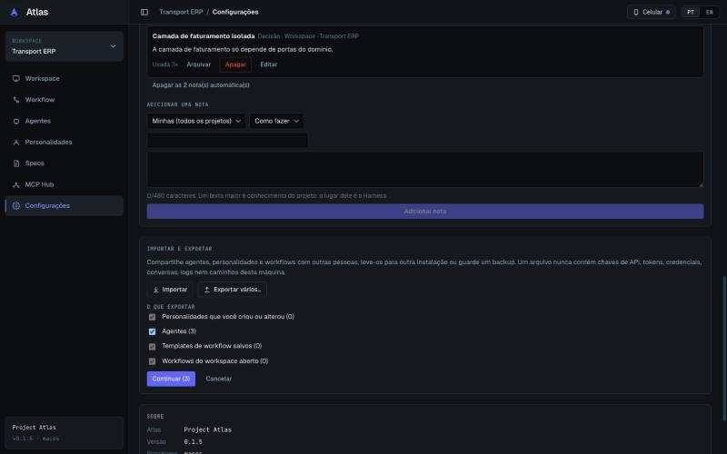 | 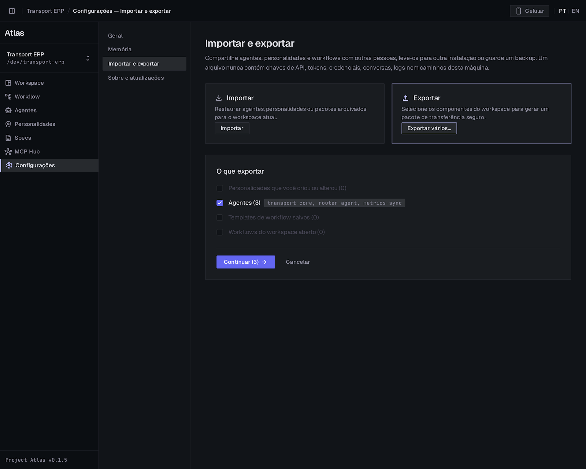 | 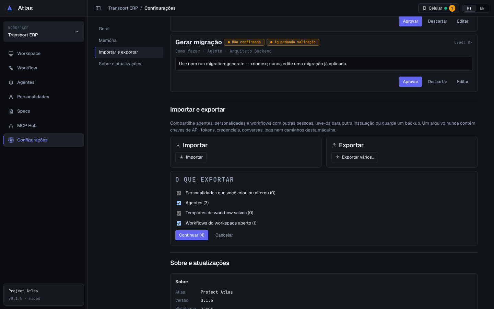 |

### C4. Configurações — Revisar importação — fiel com ajustes

Modal largo com selos de arquivo e versão e itens recolhíveis. Capturada com o mock estendido (`pick_config_file`, `preview_config_import`).

| Antes                                      | Stitch                                         | Depois                                    |
| ------------------------------------------ | ---------------------------------------------- | ----------------------------------------- |
| 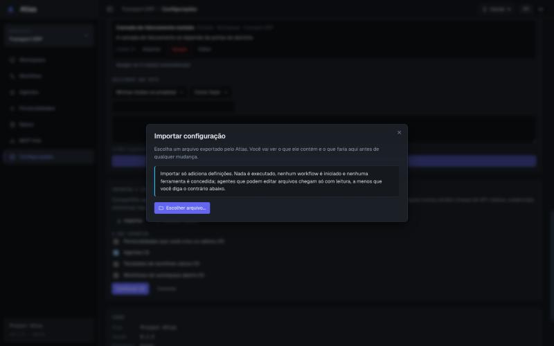 | 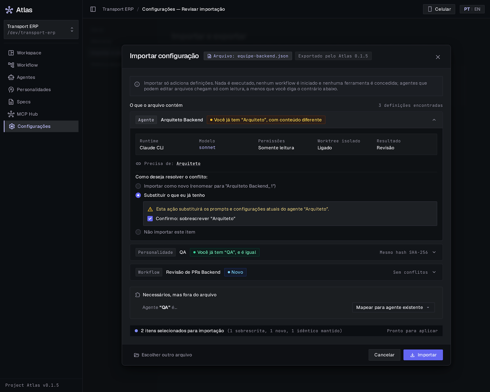 | 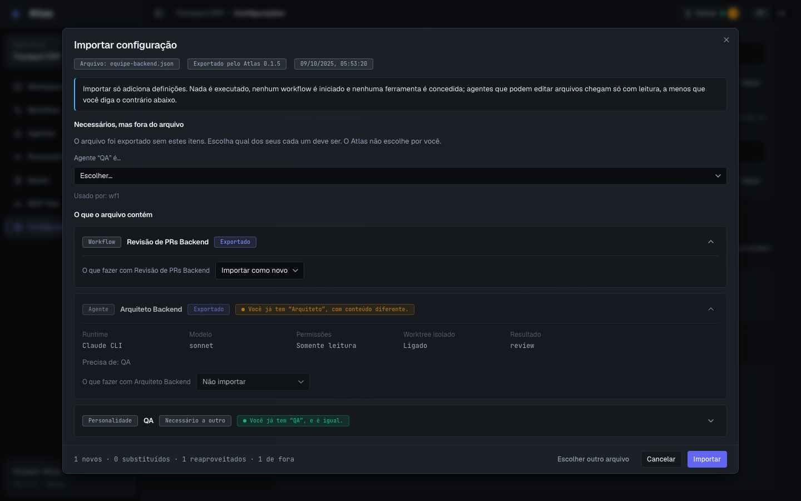 |

### C5. Configurações — Sobre e atualizações — fiel com ajustes

Cartão único com Sobre e Atualizações e ponto de estado.

| Antes                                        | Stitch                                         | Depois                                    |
| -------------------------------------------- | ---------------------------------------------- | ----------------------------------------- |
| 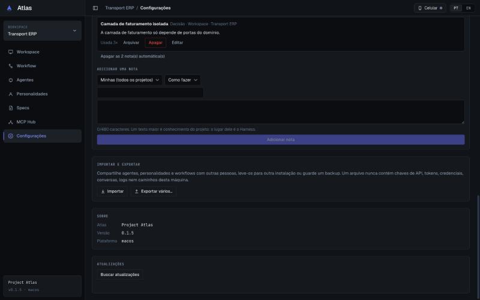 | 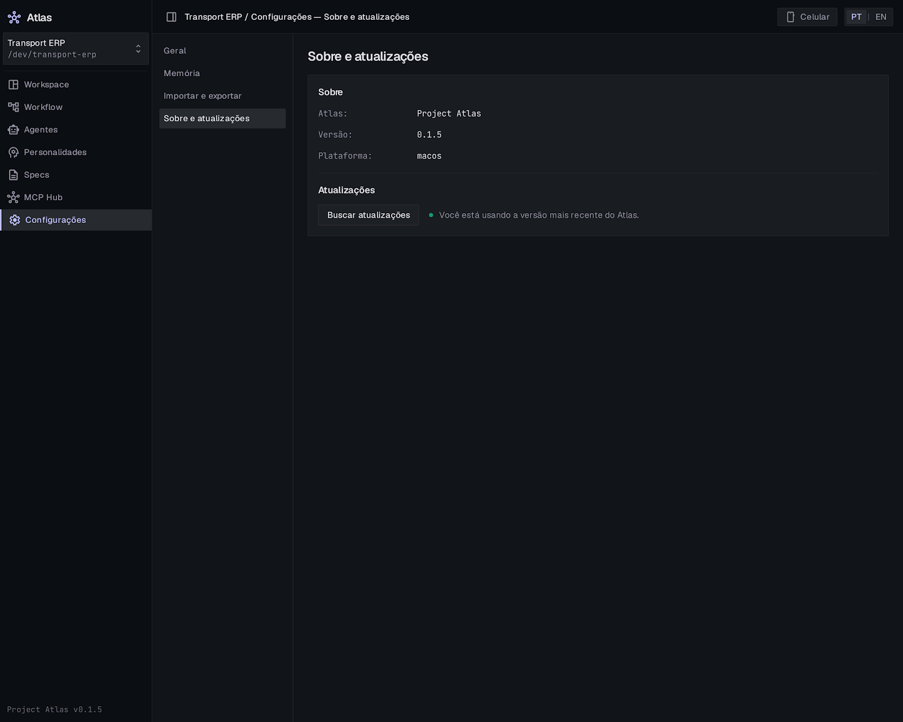 | 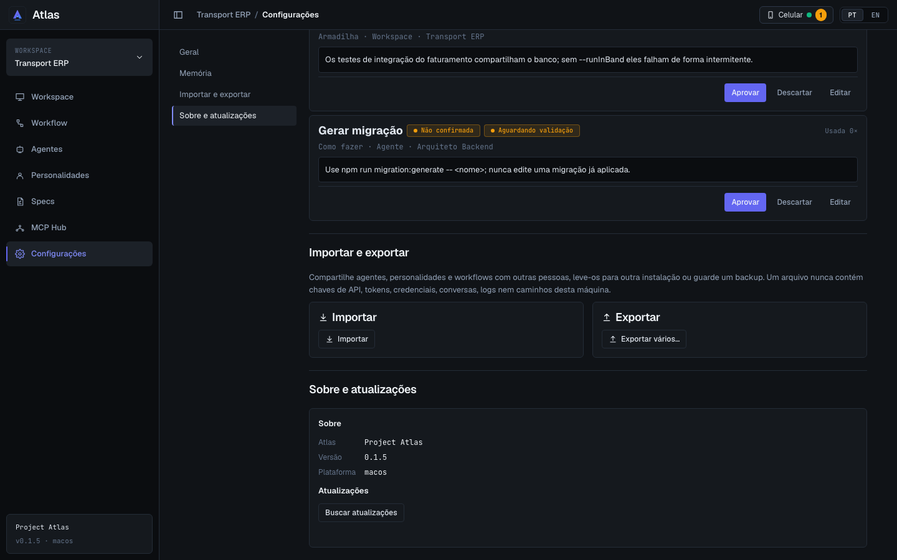 |

## 2. O Stitch mostra, o app não tem (não implementado)

- Rótulo "PREFERÊNCIAS" e chevron no índice; "segurança & isolamento" na linha "Como funciona".
- Memória: as três linhas de resumo no fim da página; o texto de exemplo da nota.
- Importar e exportar: descrições dos cartões, chip com os nomes dos agentes, seta em "Continuar (3)", borda de foco no cartão Exportar.
- Revisar importação: "3 definições encontradas", "Mesmo hash SHA-256", "Sem conflitos", seletor "Mapear para agente existente", faixa final "Pronto para aplicar".

## 3. Stitch omitiu, app manteve

- Todo texto de ajuda: nenhum foi removido; os longos (sandbox) foram para "Como funciona".
- O texto completo dos selos de proveniência (em `title` e para leitor de tela), os modos de memória "Automático", "Fazer meu" (promover) e "Usar de novo".
- "Apagar as N nota(s) automática(s)", a ajuda de cada modo e o contador de 480 caracteres.
- O aviso de substituir e a confirmação de sobrescrever (nenhuma opção e nenhuma confirmação vêm marcadas).
- Escolha do workspace, permissões e modelo/runtime na revisão da importação, e o resultado final.

## 4. Divergências intencionais

- **Uma página com índice que rola** (plano) em vez de uma seção por tela: cada tela do Stitch virou uma seção, na mesma ordem do índice. Abaixo de ~56 rem de página o índice vira uma faixa de âncoras no topo.
- **Memória em abas** (como o Stitch); a aba que abre é a de decisões, se houver algo esperando, senão a de configuração, e só muda quando a pessoa muda.
- **Arquivar e Apagar** no ⋯ de cada nota guardada.
- **Itens da importação**: abertos os escolhidos e os com conflito; a dependência sem problema fica recolhida.
- **Escolha de decisão** continua sendo uma lista (o Stitch desenhou rádios) para não mexer na lógica de decisões.

## 5. Componentes compartilhados alterados

| Mudança                                                                              | Quem mais usa                                        | Verificação                                        |
| ------------------------------------------------------------------------------------ | ---------------------------------------------------- | -------------------------------------------------- |
| `ImportDialog` / `ImportItemCard` (selos, itens recolhíveis, modal largo na revisão) | botão Importar em Agentes, Personalidades e Workflow | testes do diálogo; Agentes e Personalidades verdes |
| `PortabilitySettings` (dois cartões)                                                 | só Configurações                                     | testes                                             |
| `Badge`, `CollapsibleSection`, `OverflowMenu` reaproveitados sem mudança             | —                                                    | —                                                  |

## 6. `npm run check` e testes alterados

- Final: ver o fim deste arquivo.

**Testes alterados (mesmas asserções, caminho novo):**

- `MemorySettings.test.tsx`: as seções são abas; os testes abrem "Kept notes" ou "Add a note" antes de agir; ao aprovar ou descartar a última nota, a aba continua aberta e a nota some da lista.
- `ImportDialog.test.tsx`: uma dependência sem problema começa recolhida; os dois testes que agem sobre ela a expandem antes.

## 7. Pendências e sugestões

- Não capturados: sandbox indisponível, atualização disponível/instalando, limite inválido e o resultado final da importação (cobertos pelos testes).
- Responsividade: `chk.js` limpo em 720, 1100, 1280, 1440, 1920 e 2560 para Geral, Memória (com e sem notas), Importar e exportar, a revisão da importação e Sobre.
- A moldura do Stitch nesta rodada trazia a barra superior por cima da lateral (C3); ignorada.

- Final: **verde** — typecheck, lint, Prettier, 70 arquivos / 777 testes, `cargo fmt`, `clippy` e `cargo test`. Rust, DTOs e comandos intocados.
