# Relatório — repaginação do MCP Hub

Branch `design/workspace-harness` (continuação). Referência: [`../stitch/`](../stitch/). Levantamento: [`levantamento.md`](levantamento.md). Capturas a 1440×900 com `_comum/captura/` (`?mcp=some|none`).

## 1. Por tela

### H1. MCP Hub — Servidores — fiel com ajustes

Cabeçalho com menu Configuração, métricas em uma linha, cartões com avisos recolhíveis, inspetor com Guardrails recolhido e menu ⋯.

| Antes                               | Stitch                                 | Depois                            |
| ----------------------------------- | -------------------------------------- | --------------------------------- |
| 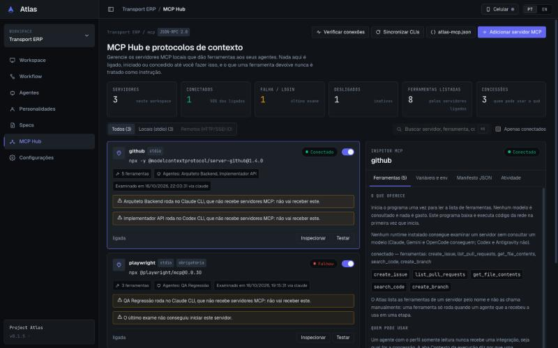 | 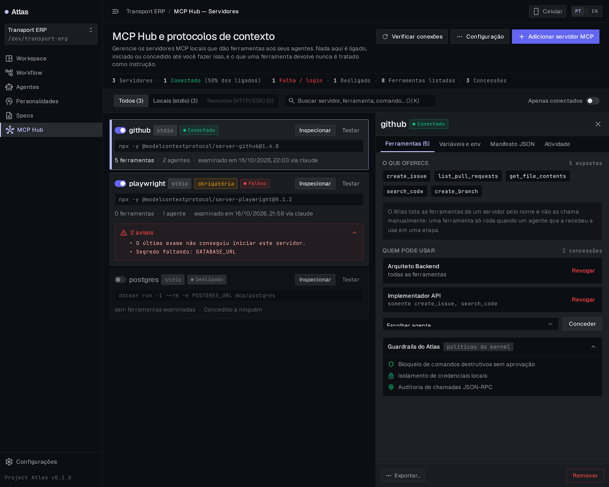 | 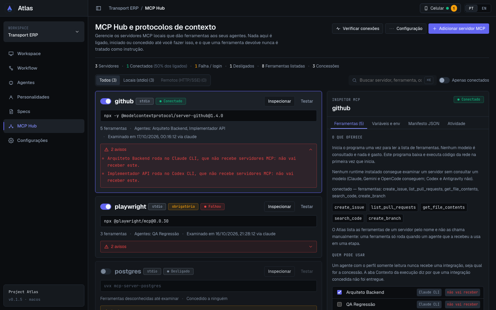 |

### H2. MCP Hub — Sem servidores — fiel

Cabeçalho da lista e cartão central; métricas e filtros só aparecem com servidores.

| Antes                              | Stitch                                     | Depois                                |
| ---------------------------------- | ------------------------------------------ | ------------------------------------- |
| _não capturado (lacuna do dossiê)_ | 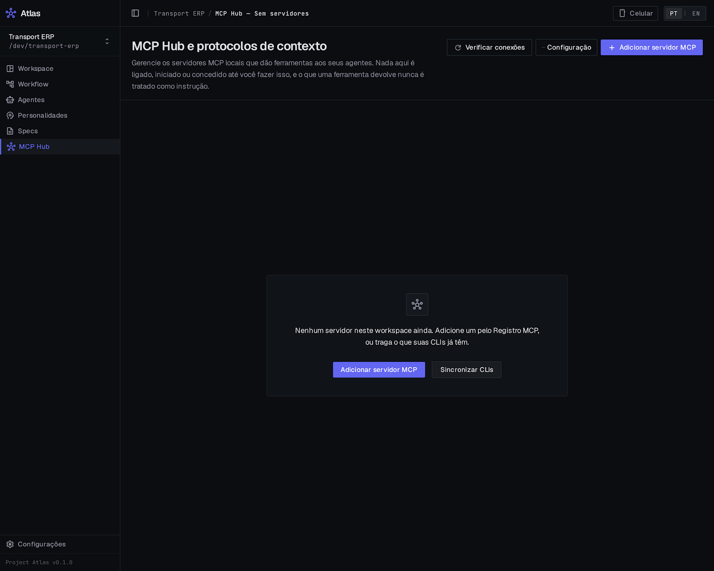 | 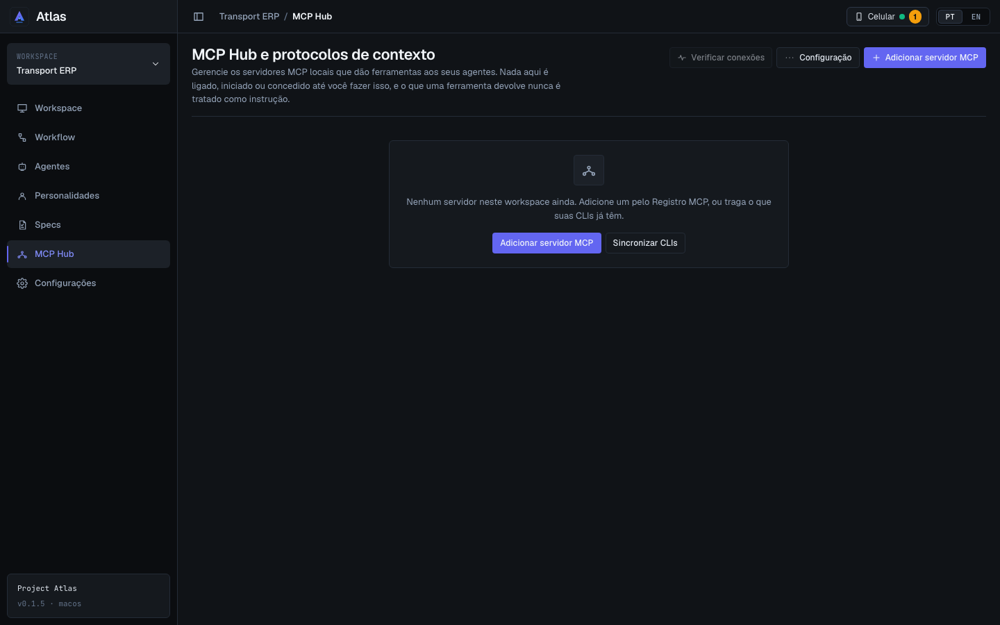 |

### H3. MCP Hub — Adicionar servidor — fiel com ajustes

Modal largo, abas sublinhadas e cartões do catálogo com selo de risco, comando em bloco e requisitos como selos.

| Antes                                        | Stitch                                         | Depois                                    |
| -------------------------------------------- | ---------------------------------------------- | ----------------------------------------- |
| 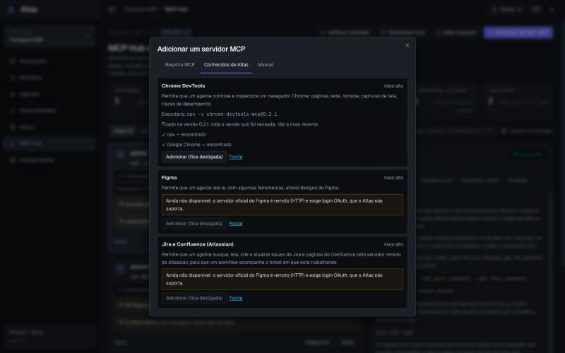 | 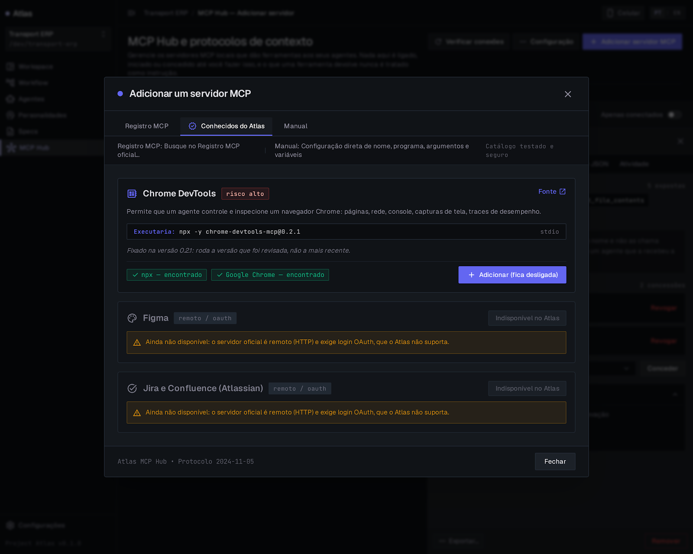 | 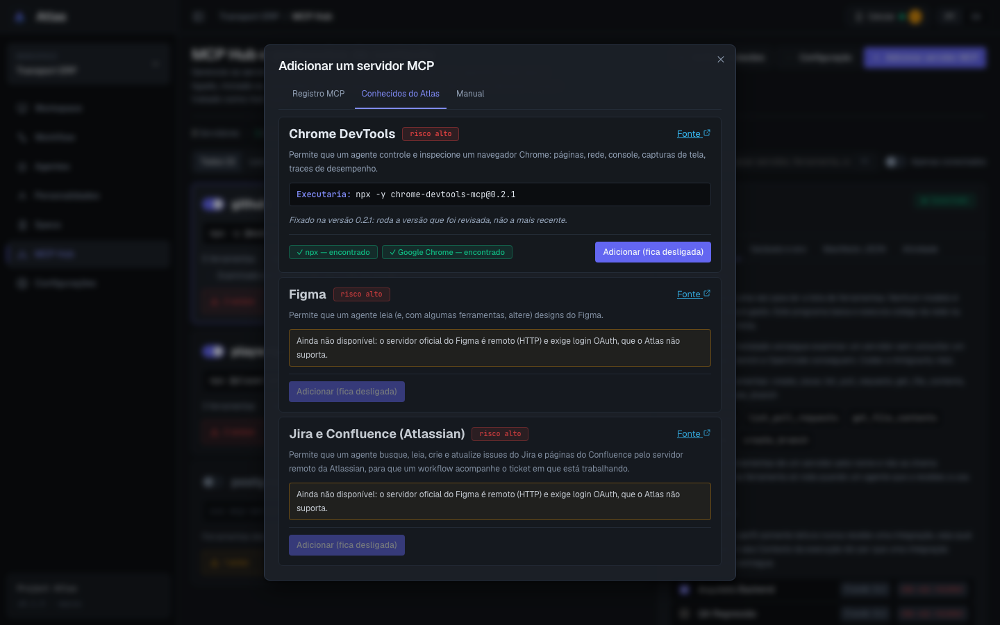 |

### H4. MCP Hub — Importar e exportar configuração — fiel com ajustes

Estrutura já era a do Stitch; ganhou as abas sublinhadas e o mesmo sistema de selos.

| Antes                                            | Stitch                                        | Depois                                   |
| ------------------------------------------------ | --------------------------------------------- | ---------------------------------------- |
| 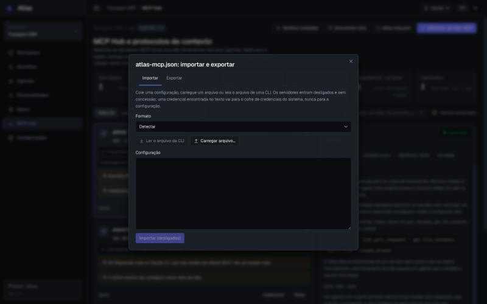 | 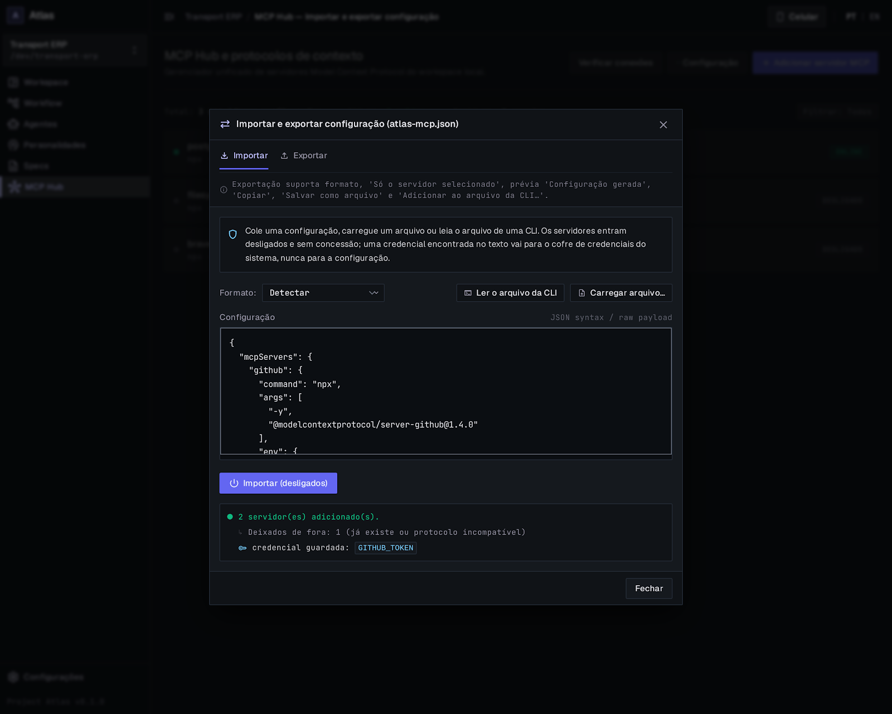 | 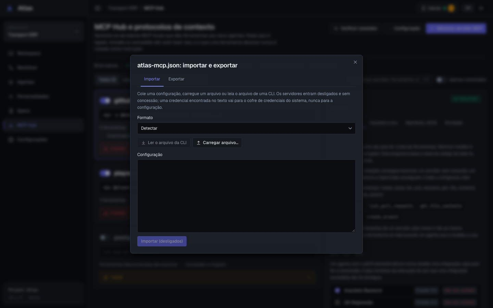 |

### H5. MCP Hub — Sincronizar CLIs — fiel com ajustes

Cartões de estado das CLIs e tabela com selos de texto. Capturada com o mock estendido (`plan_mcp_sync`), porque o antes ficava em "Lendo os arquivos…".

| Antes                                                 | Stitch                                       | Depois                                  |
| ----------------------------------------------------- | -------------------------------------------- | --------------------------------------- |
| 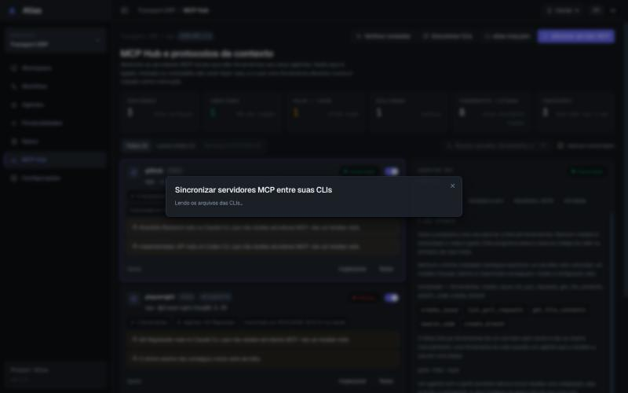 | 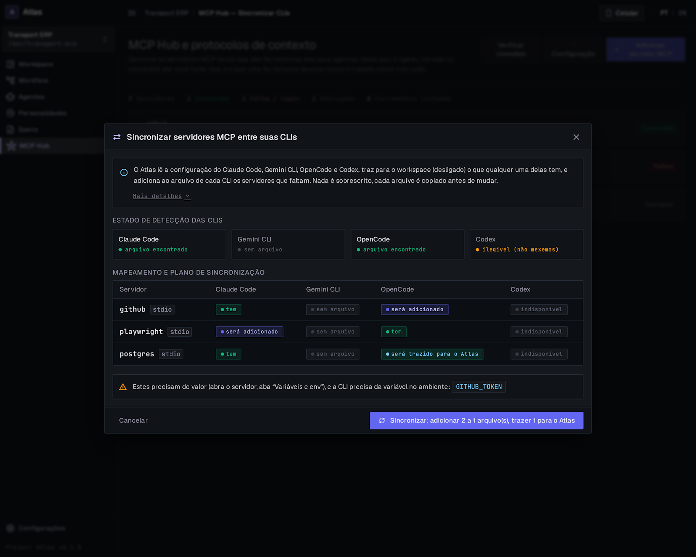 | 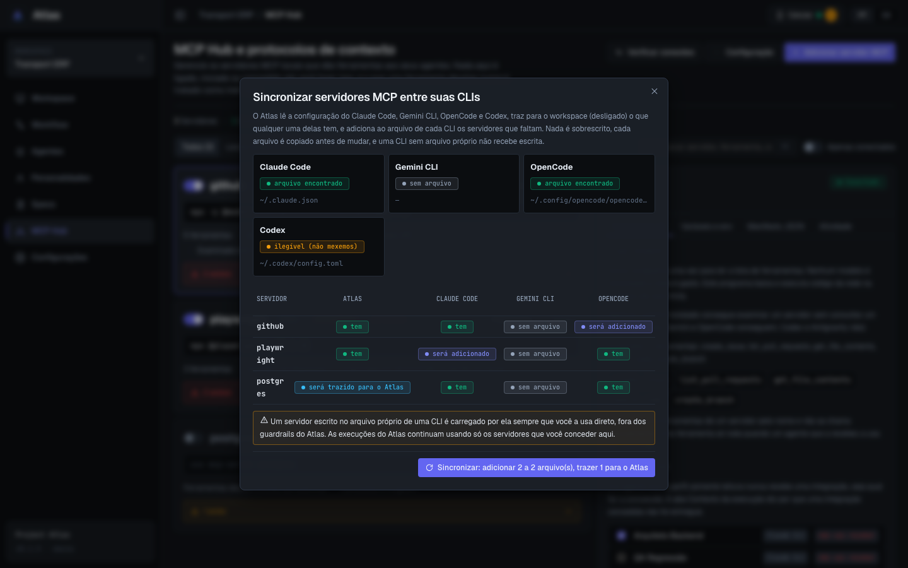 |

## 2. O Stitch mostra, o app não tem (não implementado)

- Moldura: nome inteiro da tela no breadcrumb e ícone do hub no logo (H2).
- H3: "Catálogo testado e seguro", "Atlas MCP Hub • Protocolo 2024-11-05", chips "remoto / oauth", ícones nos cartões, o texto "Indisponível no Atlas" no botão, linhas de descrição de "Registro MCP" e "Manual" no topo.
- H4: "JSON syntax / raw payload", a faixa de descrição da aba Exportar, ícones; o motivo "já existe ou protocolo incompatível".
- H5: títulos de seção "Estado de detecção das CLIs" e "Mapeamento e plano de sincronização", chip `stdio` ao lado do servidor na tabela, ícones.
- H1: rodapé "ligada/desligada" em cada cartão (o app tinha; o Stitch não, e a chave e o selo já dizem).

## 3. Stitch omitiu, app manteve

- As seis métricas e as dicas de cada uma (viraram tooltip).
- Todos os avisos de cada servidor (agente numa CLI que não recebe MCP, falha do último exame, segredo faltando) e o botão "Copiar o comando para adicioná-lo": ficam no indicador "N avisos".
- Confirmação "Ligar…" ao ligar um servidor e a confirmação de remover.
- O motivo real de cada servidor deixado de fora na importação.

## 4. Divergências intencionais

- **Avisos recolhidos por padrão:** o Stitch mostrou os do playwright abertos; aqui ficam fechados com a contagem e o tom (vermelho se há falha ou agente sem MCP; âmbar nos demais). Nada fica sem sinal.
- **Sincronizar CLIs e atlas-mcp.json** ficam no menu "Configuração" (um clique a mais); o rótulo do segundo continua sendo o nome do arquivo.
- **Remover e Exportar** no ⋯ do inspetor, com Remover em vermelho.
- **Modais de adicionar e sincronizar** passaram para o tamanho largo (a tabela precisa de espaço); o de importar/exportar continua médio.
- **Abaixo de ~62 rem de página** a lista e o inspetor empilham (o inspetor continua o do servidor selecionado).

## 5. Componentes compartilhados alterados

| Mudança                                                     | Quem mais usa                                                             | Verificação |
| ----------------------------------------------------------- | ------------------------------------------------------------------------- | ----------- |
| `OverflowMenu`: propriedade `text` (botão "⋯ Configuração") | Workspace, Agentes, Personalidades (sem mudança para quem não usa `text`) | testes      |
| `Badge`: já com `caps` e tom `policy` do módulo 2           | —                                                                         | —           |

`connectionParts` e `McpPanel` (gaveta do agente) não foram tocados.

## 6. `npm run check` e testes alterados

- Final: ver o fim deste arquivo.

**Testes alterados (mesmas asserções, caminho novo):** em `McpHubPage.test.tsx`, as métricas são lidas na lista "Hub summary" (antes numa `dl`); o aviso de entrega abre o indicador "N warnings" antes de ser lido; "Sync CLIs" e "atlas-mcp.json" passam pelo menu "Configuration".

## 7. Pendências e sugestões

- Estados não capturados: verificação em andamento, 30+ servidores, aba Manual, exportar com prévia, confirmação de ligar/remover (cobertos pelos testes).
- Responsividade: `chk.js` limpo em 720, 1100, 1280, 1440, 1920 e 2560 para a lista (com e sem aviso aberto), o vazio e os três diálogos.
- Próximo módulo (Configurações): o `OverflowMenu` com texto e o padrão de nota/estado em selos servem para os cartões de importar/exportar.

- Final: **verde** — typecheck, lint, Prettier, 70 arquivos / 777 testes, `cargo fmt`, `clippy` e `cargo test`. Rust, DTOs e comandos intocados.
